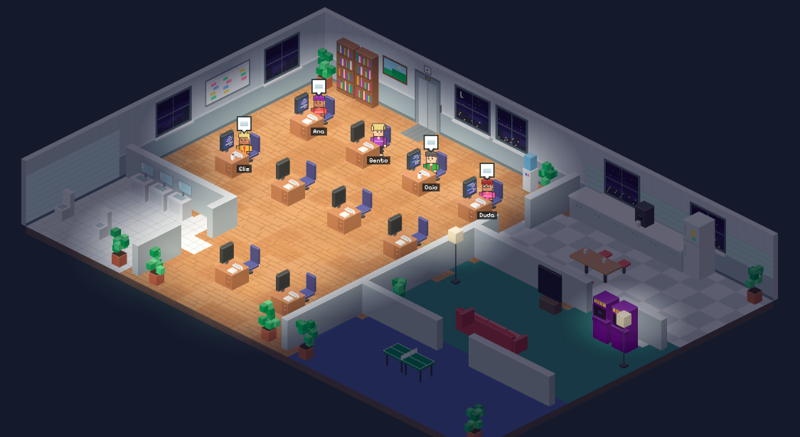
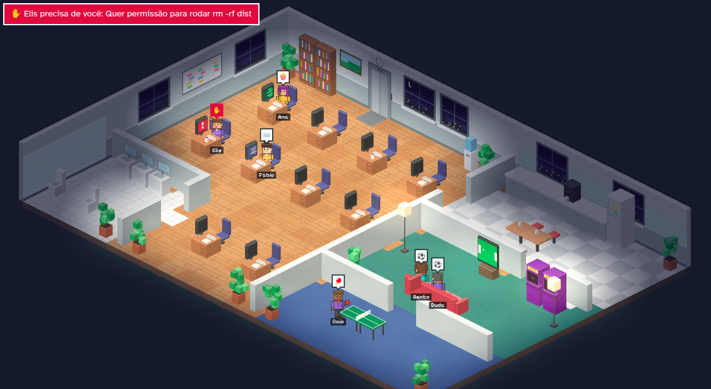

# AI AgentSquad



Um escritório em pixel art que mostra, em tempo real, o que cada sessão do Claude Code está fazendo:
quem está trabalhando, quem precisa de você e quem ficou livre (e foi tomar um café).

Funciona no **Linux** (testado no Ubuntu), no **Windows** e no macOS. Não tem dependências: só o Node.

## O que você vê



- **Trabalhando:** o agente digita na mesa e o monitor mostra código.
- **Precisa de você:** corre para a mesa, levanta a mão e um aviso aparece no topo.
- **Esperando o terminal:** fica na mesa com uma ampulheta, que vira pipoca se demorar.
- **Livre:** vai para a cozinha, o lounge, o banheiro ou a sala de jogos, conforme o jeito de cada um.

## Requisitos

- **Node.js 18 ou mais novo**. Confira com `node -v`.
  - **Ubuntu:** o `nodejs` do `apt` costuma ser antigo. Use o nvm:
    ```bash
    curl -o- https://raw.githubusercontent.com/nvm-sh/nvm/v0.40.1/install.sh | bash
    # feche e abra o terminal
    nvm install --lts
    ```
  - **Windows:** instale a versão LTS em https://nodejs.org ou rode `winget install OpenJS.NodeJS.LTS` no PowerShell.
- **Claude Code** instalado, para ver as suas sessões de verdade. Sem ele, o escritório roda só a demonstração.

## Instalação

Os comandos são os mesmos no terminal do Ubuntu e no PowerShell do Windows.

```bash
cd AI-AgentSquad
npm start
```

Abra http://localhost:4321. Sem nenhuma sessão aberta, aparece a demonstração com agentes fictícios.

### Ligar no Claude Code

Num segundo terminal, na pasta do projeto:

```bash
npm run hooks:instalar
```

O comando adiciona hooks no `settings.json` do Claude Code (`~/.claude/settings.json` no Linux,
`C:\Users\<você>\.claude\settings.json` no Windows). Antes de mexer, ele salva um backup ao lado do arquivo,
e os hooks que você já tinha continuam lá.

Depois, abra uma **sessão nova** do Claude Code em qualquer projeto. O agente chega pelo elevador e a
demonstração desliga sozinha. Se o Claude Code avisar que os hooks mudaram, revise e aceite em `/hooks`.

> O caminho do hook fica gravado no `settings.json`. Se mover a pasta do projeto, rode `npm run hooks:instalar` de novo.

### Testar sem abrir o Claude Code

Com o servidor ligado:

```bash
npm run hooks:testar
```

Uma sessão de mentira passa pelo hook de verdade: chega, lê, edita, pede permissão, roda testes e vai embora.

## Comandos

| Comando                  | O que faz                                           |
| ------------------------ | --------------------------------------------------- |
| `npm start`              | Abre o escritório em http://localhost:4321          |
| `npm run dev`            | O mesmo, reiniciando quando você muda o servidor    |
| `npm run demo`           | Abre com a demonstração sempre ligada               |
| `npm run hooks:instalar` | Liga o escritório no Claude Code                    |
| `npm run hooks:remover`  | Tira os hooks do escritório do `settings.json`      |
| `npm run hooks:testar`   | Simula uma sessão para conferir se está tudo ligado |

Outra porta: `npm start -- --porta 4322`. Nesse caso, avise o hook com a variável `ESCRITORIO_URL`
(por exemplo `ESCRITORIO_URL=http://127.0.0.1:4322`).

## Como funciona

```
Claude Code ──hook──▶ hooks/enviar-evento.js ──POST /api/hook──▶ servidor Node ──SSE──▶ navegador (canvas)
```

| Evento do Claude Code      | O que acontece no escritório                                     |
| -------------------------- | ---------------------------------------------------------------- |
| `SessionStart`             | O agente chega pelo elevador                                     |
| `UserPromptSubmit`         | Vai para a mesa trabalhar                                        |
| `PreToolUse`               | Mostra o que está fazendo (lendo, editando, rodando um comando…) |
| `Notification` (permissão) | Corre para a mesa e levanta a mão                                |
| `PostToolUse`              | Volta a trabalhar depois da sua resposta                         |
| `Stop`                     | Fica livre e vai para a cozinha ou o lounge                      |
| `SessionEnd`               | Vai embora pelo elevador                                         |

- **Privacidade:** o hook manda só o nome do evento, a pasta, o nome da ferramenta e um resumo dela
  (caminho do arquivo, comando). O seu prompt e o conteúdo dos arquivos nunca saem do Claude Code.
  O servidor só escuta na própria máquina (`127.0.0.1`).
- **Segurança do Claude:** o hook nunca imprime nada, nunca falha e desiste em menos de 1 segundo
  se o escritório estiver fechado. Com o servidor desligado, o Claude Code segue normal.
- **A planta:** fica na grade `PLANTA`, no começo do script de `public/index.html`. A legenda está no comentário.
- **A arte:** é toda gerada por código (sem imagens). Móveis viram sprites em cache na abertura; a projeção
  isométrica fica só na função `P()`. Para trocar por sprites prontos, use `spriteDeImagem()` no lugar da função do móvel.
- **Dia e noite:** segue o relógio do computador (ou o botão “Hora”). À noite, a luz de cada cômodo só acende quando tem alguém lá.

## Estrutura

```
public/index.html          a página
public/css/escritorio.css  estilos da interface
public/js/planta.js        a grade do escritório e os lugares de cada atividade
public/js/motor.js         projeção isométrica e rasterização em pixel
public/js/cenario.js       piso, paredes, janelas, dia e noite
public/js/moveis.js        cada móvel, desenhado por código
public/js/personagem.js    os personagens e suas poses
public/js/simulacao.js     agentes, subagentes, vida social e demonstração
public/js/quadro.js        desenho de cada quadro, iluminação e câmera
public/js/interface.js     painel, botões e avisos (som e notificação)
public/js/conexao.js       conexão com o servidor e laço principal
scripts/gerar-pagina-unica.js  junta tudo num HTML só (npm run build:unico)
```

## Problemas comuns

- **Ninguém aparece:** confira se o servidor está ligado, se você abriu uma sessão _nova_ depois de instalar
  os hooks e rode `npm run hooks:testar`.
- **“A porta 4321 já está em uso”:** outro processo usa a porta. Use `--porta` (veja acima).
- **`node` não encontrado no Windows:** feche e abra o PowerShell depois de instalar o Node.
- **Mais de 10 sessões:** a planta atual tem 10 mesas; quem passar disso não aparece até liberar uma mesa.

## Como contribuir

Contribuições são bem-vindas! Alguns pontos fáceis para começar:

- **Falas dos personagens:** ficam no começo de `public/js/simulacao.js`, em `FALAS` (por atividade),
  `CONVERSA` (assuntos da cozinha) e `REACOES` (respostas). Dá para usar `{outro}` (nome de um colega),
  `{jogador}` (quem está jogando) e `{projeto}` (o projeto de quem fala).
- **Personalidades:** a lista `PERSONAS`, no mesmo arquivo, define o nome, o jeito, o bordão e o que
  cada um gosta de fazer quando está livre.
- **Planta do escritório:** a grade `PLANTA` em `public/js/planta.js`. A legenda está no comentário logo acima.
- **Móveis:** cada caractere da planta tem uma função de desenho em `public/js/moveis.js`.

Para testar sem abrir o Claude Code, rode `npm run demo` (agentes fictícios) ou, com o servidor ligado,
`npm run hooks:testar` (uma sessão simulada passando pelo hook de verdade).

Abra uma _issue_ para discutir ideias maiores antes de começar, ou mande um _pull request_ direto
para ajustes pequenos.

## Inspiração

A ideia deste projeto veio do [Habblaud](https://github.com/marmottajr/habblaud), de Márcio Junior:
um escritório em pixel art onde cada agente do Claude Code vira um personagem. Todo o crédito pela
ideia original vai para ele. O código e a arte deste repositório foram escritos do zero.

## Licença

[MIT](LICENSE) © 2026 River Diniz. As fontes Pixelify Sans e Atkinson Hyperlegible são carregadas do
Google Fonts e distribuídas sob a SIL Open Font License.
